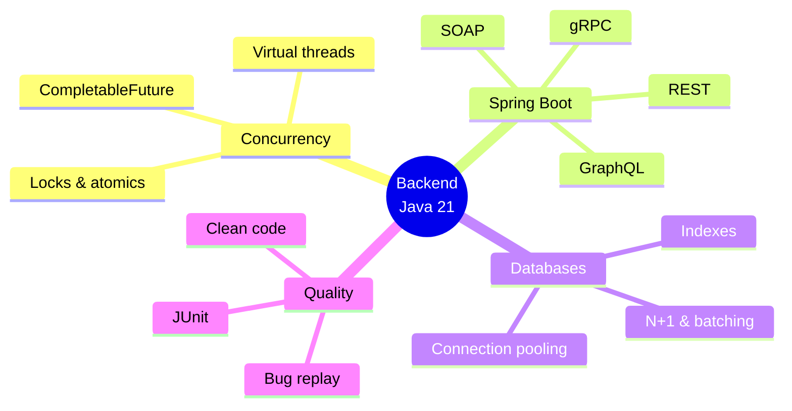

## Hi, I'm Ioana 👋

Backend engineer working with **Java 21 & Spring Boot**. I like digging into
concurrency, database performance and making bugs reproducible.
CS graduate, Faculty of Computer Science, Iași.

### What I'm working on
- 🧵 Modern Java concurrency, from threads to virtual threads
- 🗄️ Database performance: indexes, N+1, batching, pooling
- 🔌 API styles compared: REST, gRPC, GraphQL, SOAP

### Featured projects
- [bug-replay](https://github.com/dana-stc/bug-replay): record a failing request and turn it into a JUnit repro test
- [java-concurrency-study-plan](https://github.com/dana-stc/java-concurrency-study-plan): locks, atomics, executors, CompletableFuture with runnable samples
- [db-performance-guide](https://github.com/dana-stc/db-performance-guide): runnable experiments on indexes, pagination and pooling
- [senior-engineer-study-plan](https://github.com/dana-stc/senior-engineer-study-plan): a roadmap from clean code to system design

### Writing
Articles on Java and backend: [medium.com/@ioana.recianu](https://medium.com/@ioana.recianu)
